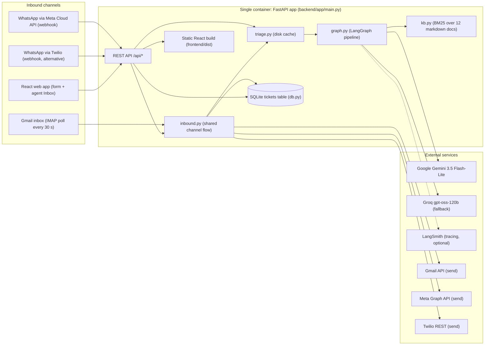
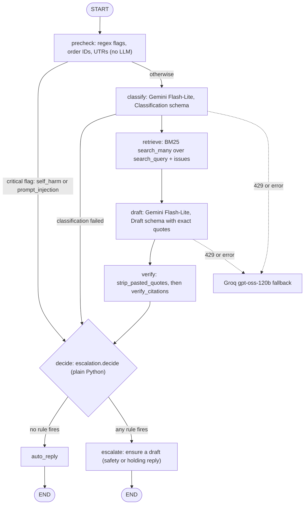
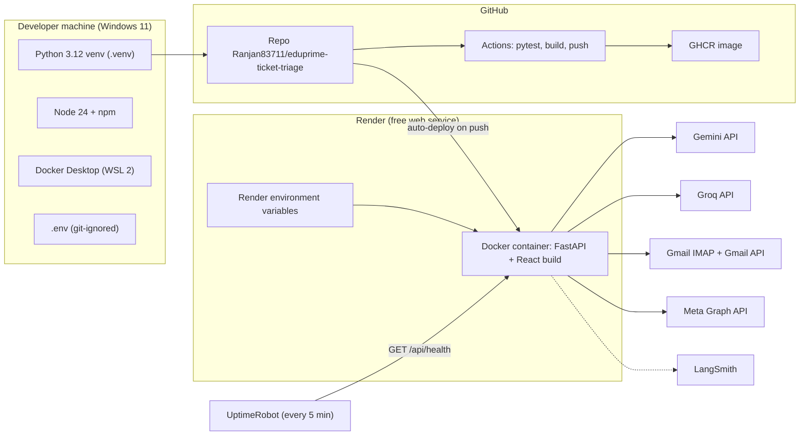

# Architecture

Source of truth: the code in `backend/app/` and `frontend/src/` (audited 2026-10-12, commit `eb7f040`).
Labels: **[V]** verified in code · **[H]** from development history · **[I]** inference · **[?]** unknown.
A static rendering of the pipeline is in [`architecture.svg`](architecture.svg). If a Mermaid diagram below fails to render on GitHub (this happened once with the README), view this file in an editor with Mermaid support.

---

## 1. Overall system architecture



**How it fits together [V].** Everything runs in one Python process. Data enters through four doors:
1. the **email poller thread** (`email_channel._poll_forever`), started in `lifespan`;
2. the **Meta webhook** (`POST /api/whatsapp/meta-webhook`);
3. the **Twilio webhook** (`POST /api/whatsapp/webhook`);
4. the **web form** (`POST /api/triage`).

All of them call `triage()` (`triage.py`), which returns a cached result or runs the LangGraph pipeline (`graph.py`). The pipeline reads the in-memory BM25 index (`kb.py`) and calls Gemini (falling back to Groq) through `llm.py`. Results are stored as one row per ticket in SQLite (`db.py`). For channel tickets, `inbound.py` sends the reply or acknowledgement back out through the Gmail API, Meta Graph API or Twilio, and logs each delivery on the ticket. The React app reads tickets via `GET /api/tickets` (polling every 5 s) and lets agents approve replies (`POST /api/tickets/{id}/resolve`). The same FastAPI app serves the built React files.

Deployment: Docker image on **Render** (free tier, Singapore), kept awake by **UptimeRobot**; CI on **GitHub Actions** publishes the image to **GHCR** [V/H].

---

## 2. End-to-end flow: an email ticket

```mermaid
sequenceDiagram
    participant S as Student
    participant G as Gmail inbox
    participant P as Poller thread (email_channel)
    participant I as inbound.process_incoming
    participant T as triage() + LangGraph
    participant D as SQLite
    participant A as Gmail API
    participant SS as Senior Support inbox
    participant AG as Agent (React Inbox)

    S->>G: email
    loop every 30 s
        P->>G: IMAP UNSEEN (fetch marks as read)
    end
    P->>P: parse_message: skip machine mail, strip quotes and signatures
    P->>I: item {contact, name, subject, message_id, references, text}
    I->>T: triage(text, "email")
    T-->>I: TriageResult (decision, draft, citations, reasons)
    I->>D: save_result(result, meta)
    alt decision = auto_reply
        I->>A: reply in thread (no [n] markers, help articles, ticket #)
        I->>D: delivery logged (or status send_failed)
    else decision = escalate
        I->>A: acknowledgement to student (team named; helpline if self-harm)
        I->>A: alert email to SENIOR_SUPPORT_EMAIL with reasons and draft
        AG->>D: GET /api/tickets (every 5 s)
        AG->>I: POST /api/tickets/{id}/resolve (edited reply)
        I->>A: agent reply in the same thread
    end
```

WhatsApp via Meta is the same, except: Meta POSTs JSON → signature check → `BackgroundTasks` runs `process_incoming("whatsapp", item)` after a fast 200 → replies via `meta_whatsapp.send_text` [V].
WhatsApp via Twilio: the webhook waits up to `WEBHOOK_REPLY_BUDGET_S = 12` seconds; if triage finishes, the student-facing message is returned as TwiML in the HTTP response (via `inbound.ReplySlot`), otherwise a holding message is returned and the pipeline later tries the REST API [V].

---

## 3. AI pipeline (LangGraph)



**State [V]** (`TriageState`, a TypedDict): `ticket, channel, precheck, classification, passages, draft, citation_checks, decision, llm_calls, error`. No conversation memory: each ticket is triaged independently.
**Error handling [V]:** `classify_node` and `draft_node` catch all exceptions and set `error`; `decide_node` appends the error to the reasons; the ticket escalates with a holding reply.
**Retry [V]:** `llm.call_structured` retries the whole Gemini→Groq chain after 10 s and 25 s if the error looks like a rate limit (`429`, `RESOURCE_EXHAUSTED`, `RateLimit`).

---

## 4. Codebase map

### Backend (`backend/app/`)

| File | Responsibility | Main symbols | Called by | Calls |
|---|---|---|---|---|
| `main.py` | App, startup, routes, SPA | `lifespan`, `health`, `triage_ticket`, `tickets`, `ticket`, `resolve`, `whatsapp_webhook`, `meta_webhook_verify`, `meta_webhook`, `kb`, `eval_report`, `spa`; constants `WEBHOOK_REPLY_BUDGET_S=12`, `HOLDING_WHATSAPP` | uvicorn | db, email_channel, inbound, meta_whatsapp, whatsapp_channel, kb, triage |
| `config.py` | Loads `ROOT/.env`; every setting; disables LangSmith tracing if no key; `MODEL_PRICES`; `PROMPT_VERSION="v5"` | constants | all modules | python-dotenv |
| `schemas.py` | Pydantic types | `Classification`, `Citation`, `Draft` (LLM outputs); `PrecheckResult`, `Passage`, `CitationCheck`, `EscalationDecision`, `LLMCall`, `TriageResult`, `TicketIn` | graph, llm, db, main, tests | — |
| `prechecks.py` | Deterministic flags | `RULES` (name → (regex, critical)), `run_prechecks` | graph | — |
| `kb.py` | Markdown → passages (one per `##` section, id `doc#slug`), BM25 | `load_passages`, `KnowledgeBase.search/search_many`, `get_kb` (lru_cache), `tokenize` | graph, citations, triage, main | rank_bm25 |
| `prompts.py` | Prompt text | `CLASSIFIER_SYSTEM/USER`, `DRAFTER_SYSTEM/USER`, `format_passages` | graph | — |
| `llm.py` | Model clients and accounting | `_gemini`, `_groq`, `structured_chain` (lru_cache), `call_structured`, `_cost`, `RATE_LIMIT_WAITS_S=(10,25)` | graph | langchain-google-genai, langchain-groq |
| `citations.py` | Verify and clean citations | `verify_citations`, `strip_pasted_quotes`, `FUZZY_THRESHOLD=0.9`, `DUPLICATE_OVERLAP=0.5` | graph, triage | kb.tokenize |
| `escalation.py` | The rule | `decide`, `TEAM_BY_CATEGORY` | graph, eval | config |
| `graph.py` | LangGraph state machine | nodes, `build_graph`, `get_graph`, `run_graph`, `SAFETY_REPLY`, `HOLDING_REPLY` | triage, inbound (SAFETY_REPLY) | prechecks, llm, kb, citations, escalation, prompts |
| `triage.py` | Public entry with disk cache | `triage`, `_cache_key`, `_kb_fingerprint` | main, inbound, eval | graph, citations, kb |
| `db.py` | Storage | `Ticket`, `init_db`, `save_result`, `list_tickets`, `get_ticket`, `resolve_ticket`, `set_status`, `add_delivery`, `seed_if_empty` | main, inbound | SQLAlchemy |
| `inbound.py` | Channel-neutral handling | `process_incoming`, `send_agent_reply`, `student_text`, `acknowledgement`, `senior_alert`, `_send`, `_deliver`, `_to_student`, `ReplySlot`, `TEAM_NAMES` | main, email poller | db, triage, email_channel, meta_whatsapp, whatsapp_channel |
| `email_channel.py` | Gmail | `parse_message`, `clean_body`, `fetch_unseen`, `send_email`, `send_alert`, `_transmit` (Gmail API or SMTP), `_access_token`, `start_poller`, `status` | main, inbound | imaplib, smtplib, httpx |
| `meta_whatsapp.py` | Meta Cloud API | `verify_subscription`, `valid_signature`, `parse_webhook`, `is_duplicate`, `send_text`, `status` | main, inbound | httpx |
| `whatsapp_channel.py` | Twilio | `valid_signature`, `parse_webhook`, `is_duplicate`, `send_whatsapp`, `twiml`, `status` | main, inbound | httpx |

Note: the `whatsapp_channel.py` module docstring still says it "acknowledges at once and triages in the background"; the code (`main.whatsapp_webhook`) now waits up to 12 s and replies via TwiML. The docstring is stale; the behaviour described here is the real one [V].

### Tooling and data
- `backend/eval/run_eval.py`: `python -m eval.run_eval [--no-cache] [--delay 6] [--limit N]`. Runs the main set, then the held-out set; writes `eval/report.json` and `data/seed_results.json` (12 fixed ticket IDs). Exits 1 if any ticket errored [V].
- `backend/scripts/gmail_auth.py`: local OAuth loopback flow on port 8765, scope `gmail.send`, writes `GMAIL_REFRESH_TOKEN` to `.env` (never printed) [V].
- `backend/tests/`: `conftest.py` blanks all channel credentials and replaces `httpx.post` with a function that fails, so no test can reach a real service [V].

### Frontend (`frontend/src/`)
| File | Responsibility |
|---|---|
| `main.jsx` | React root |
| `App.jsx` | Header (models, email-channel badge, API status), tabs Inbox/Evaluation (hash `#eval`), lazy-loads `EvalDashboard` |
| `api.js` | fetch wrappers: health, tickets, triage, resolve, evalReport |
| `Inbox.jsx` | New-ticket form with 6 sample tickets; ticket list polled every 5 s (`POLL_MS`), "New" badges, Live indicator, filters All / Needs human / Auto-replied with counts |
| `TicketDetail.jsx` | Decision banner and reasons, sender, pre-check flags, classification, reply with clickable `[n]` citations and verification status, editable draft + "Approve & send to …", "Messages sent" delivery log, pipeline trace with tokens/latency/cost |
| `EvalDashboard.jsx` | KPI tiles, held-out row, threshold sweep chart (Recharts), confusion matrix, per-class table, per-ticket table (mismatches filter) |
| `ui.jsx` | Labels, status chips (`NEEDS_HUMAN` = pending_review, send_failed), helpers |
| `index.css` | Tailwind 4 import; colour tokens with dark-mode variants |

Dev server: `npm run dev` (Vite proxies `/api` to `localhost:8000`). Production: `npm run build` → `frontend/dist`, served by FastAPI.

---

## 5. API reference

All routes are **unauthenticated** [V]. CORS allows only `http://localhost:5173` (the Vite dev server); in production the SPA is same-origin.

| Method & route | Request | Response | Errors | Internals |
|---|---|---|---|---|
| `GET /api/health` | — | `{status, models{classifier,drafter,fallback}, keys{GOOGLE_API_KEY,GROQ_API_KEY,LANGSMITH_API_KEY: bool}, auto_reply_threshold, kb_passages, channels{email{enabled,address,last_poll,last_error,processed,sender,senior_alerts_to}, whatsapp{enabled,from,received,last_error}, whatsapp_meta{enabled,received,last_error,rejected_signature?}}}` | — | reads module status dicts |
| `POST /api/triage` | `{"text": str 1–4000, "channel": "email"\|"whatsapp"\|"form"}` | ticket dict (below) | 422 validation | `triage()` in threadpool → `db.save_result` (no outbound send) |
| `GET /api/tickets?limit=100` | — | list of ticket dicts, newest first | — | `db.list_tickets` |
| `GET /api/tickets/{id}` | — | ticket dict | 404 | `db.get_ticket` |
| `POST /api/tickets/{id}/resolve` | `{"reply": str 1–4000}` | ticket dict | 404, 422 | `db.resolve_ticket` (status `sent_by_agent`) → `inbound.send_agent_reply` (email/whatsapp only; failure → `send_failed`) |
| `POST /api/whatsapp/webhook` | Twilio form fields; header `X-Twilio-Signature` | `text/xml` TwiML | 404 if not configured, 403 bad signature | signature over the reconstructed public URL (uses `x-forwarded-proto/host`) |
| `GET /api/whatsapp/meta-webhook` | `hub.mode`, `hub.verify_token`, `hub.challenge` | challenge as plain text | 403 | `meta_whatsapp.verify_subscription` |
| `POST /api/whatsapp/meta-webhook` | Meta JSON; header `X-Hub-Signature-256` | `{"status":"ok"}` | 404, 403 (counted), 400 bad JSON | background `process_incoming` |
| `GET /api/kb` | — | list of passages `{id, doc, title, text, score}` | — | `get_kb()` |
| `GET /api/eval` | — | `eval/report.json` | 404 | file read |
| `GET /{path}` | — | SPA file or `index.html` | — | resolves inside `frontend/dist` only |

**Ticket dict [V]** (`Ticket.to_dict`): `id, created_at, channel, text, decision, team, status, final_reply, categories, sentiment, confidence, latency_ms, cost_usd, meta{contact,name,subject,message_id,references,provider,our_number,message_sid,deliveries[{kind,channel,to,ok,error?,via?,at}]}, result{…full TriageResult…}`.

---

## 6. Data model and persistence

- **Engine [V]:** SQLAlchemy 2 on SQLite, `sqlite:///{DB_PATH}`, `check_same_thread=False`. `DB_PATH` defaults to `backend/triage.db`; Docker sets `/tmp/triage.db` (ephemeral). `db.py` creates the parent folder (for Azure `/home/data`).
- **Table `tickets` [V]:** `id INTEGER PK`, `created_at DATETIME`, `channel VARCHAR(20)`, `text TEXT`, `decision VARCHAR(20)`, `team VARCHAR(30) NULL`, `status VARCHAR(20)`, `final_reply TEXT NULL`, `latency_ms INTEGER`, `cost_usd FLOAT`, `result JSON`, `meta JSON NULL`. No indexes beyond the PK, no foreign keys.
- **Create:** `save_result` (status `auto_sent` if decision is auto_reply, else `pending_review`). **Read:** `list_tickets`, `get_ticket`. **Update:** `resolve_ticket`, `set_status`, `add_delivery` (append to `meta.deliveries`, uses `flag_modified`). **Delete:** none.
- **Migrations [V]:** none as a tool. `init_db` runs `create_all`, then `ALTER TABLE tickets ADD COLUMN meta JSON` if the column is missing.
- **Seeding [V]:** if the table is empty, loads `backend/data/seed_results.json` (12 tickets). On Render every redeploy wipes `/tmp`, so the inbox returns to these samples.
- **Cache [V]:** `CACHE_DIR` (default `backend/.cache`, Docker `/tmp/triage-cache`), one JSON `TriageResult` per key. Key = sha256 of `[text, channel, classifier, drafter, fallback, PROMPT_VERSION, kb_fingerprint]`. Failed results aren't cached.
- **Concerns:** single writer process only (SQLite); JSON blobs not queryable; the `db.py` docstring's "one-line DB_URL change" isn't true (there's no URL setting; switching to Postgres needs a small code change) [V]. Real senders' contacts are stored in `meta` and exposed by the unauthenticated API [V].

---

## 7. External integrations

| Service | Purpose | Config | Failure mode | Fallback / handling |
|---|---|---|---|---|
| Google Gemini | classify + draft | `GOOGLE_API_KEY`, model names | 429 (per-minute and 500/day), 404 retired model, 400 bad params | Groq fallback; chain retry 10 s/25 s; then escalate with holding reply |
| Groq | fallback LLM | `GROQ_API_KEY`, `FALLBACK_MODEL` | 429 at 8k tokens/min | client `max_retries=3`; chain retry |
| LangSmith | tracing | `LANGSMITH_API_KEY`, `LANGSMITH_TRACING`, `LANGSMITH_PROJECT` | none to the app | tracing forced off if no key (`config.py`) |
| Gmail IMAP | read inbox | `EMAIL_ADDRESS`, `EMAIL_APP_PASSWORD`, `IMAP_HOST` | bad credentials, network | error in `status.last_error`; poller keeps retrying every 30 s |
| Gmail API | send (HTTPS) | `GMAIL_CLIENT_ID/SECRET/REFRESH_TOKEN` | token refresh 401 (`disabled_client`, `unauthorized_client`) | delivery logged as failed, ticket `send_failed` |
| Gmail SMTP | send (default) | `SMTP_HOST/PORT` | blocked on Render (`Network is unreachable`) | same as above; use Gmail API on Render |
| Meta WhatsApp Cloud API | WhatsApp in/out | `META_WA_TOKEN`, `META_WA_PHONE_NUMBER_ID`, `META_APP_SECRET`, `META_WA_VERIFY_TOKEN`, `META_GRAPH_VERSION=v25.0` | 403 signature (wrong secret), `131005` token, recipient not verified | 403 counted in health; failed send → `send_failed` |
| Twilio | WhatsApp alternative | `TWILIO_ACCOUNT_SID/AUTH_TOKEN`, `TWILIO_WHATSAPP_FROM` | trial: `21654 ContentSid Required` on REST sends | TwiML in-response replies within 12 s |
| Render | hosting | dashboard env vars | free tier sleeps after 15 min; ephemeral disk; blocks SMTP | UptimeRobot pings; seed data; Gmail API |
| GitHub Actions / GHCR | CI + image | `GITHUB_TOKEN` | — | — |

---

## 8. Integration and dependency map



Pinned dependencies: [`backend/requirements.lock.txt`](../backend/requirements.lock.txt) (Docker installs this). Key versions [V]: FastAPI 0.143.0, LangChain 1.4.4, langchain-core 1.6.9, LangGraph 1.2.14, langchain-google-genai 4.4.0, langchain-groq 1.1.3, LangSmith 0.14.5, Pydantic 2.14.0, SQLAlchemy 2.1.4, rank-bm25 0.2.2, scikit-learn 1.9.1, uvicorn 0.54.0, httpx 0.28.1, python-multipart 0.0.32. Frontend: React 19.3, Vite 8.3, Tailwind 4.3, Recharts 3.10, @vitejs/plugin-react 6.1.

---

## 9. Security model (as implemented)

- **Webhooks are authenticated** (Twilio HMAC-SHA1, Meta HMAC-SHA256, Meta verify token) [V].
- **The agent API and Inbox are not authenticated** [V]. Anyone with the URL can read all tickets (including real senders' emails and phone numbers) and trigger outbound replies via `/resolve`. This is the most important gap; see [`CURRENT_STATUS.md`](CURRENT_STATUS.md).
- **Prompt injection:** obvious phrasings are caught by regex and never reach the LLM; prompts mark tickets as data; the LLM has no tools and can't take actions [V].
- **Secrets:** only in `.env` (git-ignored, also in `.dockerignore`) and host settings. The Gmail OAuth scope is `gmail.send` only; the Meta token has two WhatsApp scopes only [V/H].
- **Loop prevention:** machine mail is ignored; outbound mail is marked `Auto-Submitted` [V].
